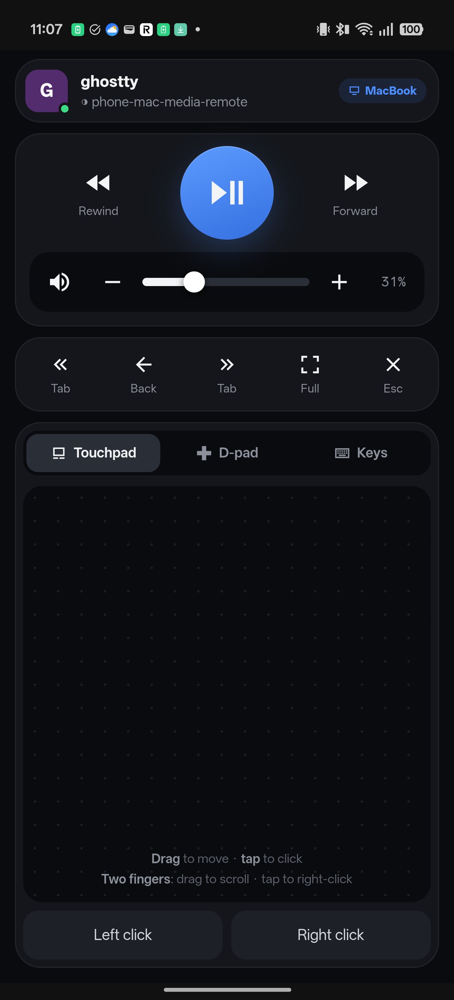

# Mac Remote

Couch remote for a Mac that's driving a TV or monitor: big media buttons, the Mac's volume, browser tab and back keys, typing, and a touchpad, over home Wi-Fi. Only your phone can control the Mac.



## Using it

- **Top card**: the app that has focus on the Mac, its window title, and which screen it's on (MacBook or Monitor). The dot turns red when the Mac can't be reached.
- **Media**: play/pause (Space), rewind and forward (←/→), and fullscreen (`f`). These work on YouTube, Netflix and most web players.
- **Volume**: drag the slider to set the Mac's level, or use −/+ and mute. The **phone's volume keys** control the Mac too.
- **Row**: previous and next tab, back, fullscreen, Esc.
- **Touchpad**: drag to move, tap to click, and two fingers to scroll. A two-finger tap right-clicks, and there are Left click and Right click buttons below the pad. Tune `SPEED` and `SCROLL` in `mac/remote.py`.
- **D-pad**: arrow keys with OK = Enter, plus Prev/Next link (Shift-Tab/Tab) to jump between links and Esc. The pressed side of the ring lights up.
- **Keys**: whatever you send gets typed on the Mac, with Delete, Space, Enter, Tab and Left/Right keys. While the phone keyboard is open, the screen shrinks to just this card.
- The bottom card switches between **Touchpad**, **D-pad** and **Keys**, and the phone remembers your choice.
- **Hold to repeat**: hold volume, rewind, forward, the arrows or the link buttons and they keep firing.

## How it works

- `mac/remote.py` is a small HTTPS server using only the Python standard library. It serves the remote page and turns button presses into keystrokes (AppleScript) and mouse and scroll events (CoreGraphics through `ctypes`). The server only accepts actions from a fixed list, and typed text is passed as an argument, never inserted into a script.
- The Android app is a full-screen WebView showing that page. It also forwards the phone's volume keys to the Mac.
- **Only your phone gets in**:
  - On first run the Mac creates a random 32-byte token and a self-signed certificate in `~/.mac-remote/`.
  - The app is built with the token, the Mac's address and the certificate's SHA-256 fingerprint compiled in. It accepts only that exact certificate, so a lookalike server on the network gets nothing.
  - Every request without the token, kept in an HttpOnly, Secure, SameSite=Strict cookie, gets a 403.
  - None of this is in the repo. Gradle reads it from `~/.mac-remote/` at build time.
- **Accessibility is granted to one app only**: `mac/launcher.c` builds a tiny `MacRemote.app` that runs `remote.py` as a child process. You grant that app Accessibility, not your terminal or every `python3` script.

## Set up

On the Mac:

```
cd mac
python3 remote.py --selftest    # rejects missing/bad tokens, etc.
./make-app.sh                   # builds MacRemote.app + a start-at-login file
open MacRemote.app              # creates ~/.mac-remote/ and asks for Accessibility
```

Turn on **Mac Remote** in System Settings → Privacy & Security → Accessibility, then quit and reopen it. To start it at login, run the `launchctl` command that `make-app.sh` prints.

On the phone (USB debugging on, from this folder):

```
./gradlew installDebug
```

The app finds the Mac by its Bonjour name (`<LocalHostName>.local`), so it keeps working when the router hands the Mac a new IP. To use a fixed address instead, put `macremote.host=<ip or name>` in `local.properties`.

## Revoking access

Delete `~/.mac-remote/token`, restart Mac Remote, and run `./gradlew installDebug` again. Any device holding the old token is locked out.
